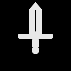
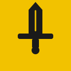
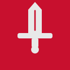
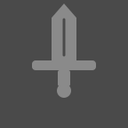

# HeroDeck

HeroDeck affiche les infos de ton personnage **World of Warcraft Forever** sur un **Elgato Stream Deck**,
en direct. Aujourd'hui : la **durabilité** de ton équipement (l'objet le plus abîmé, ou un emplacement au
choix), avec une icône dont la couleur te dit quand réparer.

HeroDeck a deux parties, et il faut les deux :

| Partie | Où elle tourne | Rôle |
|---|---|---|
| **Addon HeroDeck** | dans le jeu | lit les données du personnage et les dessine dans son bouton de minimap |
| **Plugin HeroDeck** | dans l'application Stream Deck | lit ce bouton à l'écran et affiche les valeurs sur les touches |






## Prérequis

- Windows 10 ou 11 (64 bits).
- Application **Stream Deck 7.1** ou plus récente.
- World of Warcraft Forever en mode **fenêtré** ou **fenêtré (plein écran)**. Le plein écran exclusif
  empêche le plugin de lire l'image du jeu.

## Installation

Télécharge les deux fichiers de la dernière version sur la page
[Releases](https://github.com/devilcable/HeroDeck/releases) :

- `HeroDeck-addon-<version>.zip` : l'addon ;
- `com.devilcable.herodeck.streamDeckPlugin` : le plugin.

### 1. L'addon (jeu)

1. Ferme le jeu (ou fais `/reload` après l'installation).
2. Dézippe `HeroDeck-addon-<version>.zip` dans le dossier AddOns du jeu :
   `<dossier WoW>\_forever_\Interface\AddOns\`.
   Tu dois obtenir `...\AddOns\HeroDeck\HeroDeck.toc` (pas `AddOns\HeroDeck\HeroDeck\...`).
3. Lance le jeu. Sur l'écran de choix du personnage, ouvre **AddOns** et vérifie que **HeroDeck** est
   coché. S'il est marqué « obsolète », coche l'option qui charge les AddOns obsolètes (en anglais
   **Load out of date AddOns**).
4. En jeu, un bouton rond **HeroDeck** (un petit Stream Deck) apparaît au bord de la minimap.

### 2. Le plugin (Stream Deck)

1. Double-clique sur `com.devilcable.herodeck.streamDeckPlugin`. L'application Stream Deck s'ouvre et
   propose d'installer le plugin : accepte.
2. Dans la liste des actions, ouvre la catégorie **HeroDeck** et glisse **Durability** (**Durabilité** en
   français) sur une touche.
3. Pour suivre un objet précis, sélectionne la touche et choisis l'emplacement dans **Item**.

### Mise à jour

- Addon : supprime l'ancien dossier `AddOns\HeroDeck`, puis dézippe la nouvelle version.
- Plugin : double-clique sur le nouveau `.streamDeckPlugin`, il remplace l'ancien.

### Désinstallation

- Addon : supprime le dossier `AddOns\HeroDeck`.
- Plugin : dans Stream Deck, ouvre **Préférences → Plugins**, sélectionne HeroDeck et désinstalle-le.

## Comment ça marche

Un addon WoW n'a **ni réseau, ni fichiers, ni moyen de parler à un autre programme**. HeroDeck passe donc
par l'écran : l'addon dessine les données en couleurs, le plugin les lit dans une capture de la fenêtre du
jeu.

```
 WoW Forever                                 Application Stream Deck
┌──────────────────────────────┐            ┌──────────────────────────────┐
│ Addon HeroDeck               │            │ Plugin HeroDeck              │
│  lit la durabilité           │   écran    │  capture la fenêtre de WoW   │
│  ──► code les valeurs        │ ─────────► │  trouve la grille            │
│  ──► grille de 5×3 couleurs  │  (pixels)  │  décode les valeurs          │
│      dans le bouton minimap  │            │  ──► dessine les touches     │
└──────────────────────────────┘            └──────────────────────────────┘
```

### L'addon

- Il lit la durabilité de chaque objet équipé quand elle change (dégâts, réparation, équiper, retirer).
- Il ajoute le **bouton HeroDeck** au bord de la minimap. L'icône du bouton est une grille de 5 × 3 petites
  touches. Leurs couleurs **sont** les données :
  - une ligne d'en-tête (blanc, noir, magenta, version) sert de repère et d'étalon de couleurs ;
  - les autres cases portent les valeurs, chacune avec un contrôle pour rejeter une lecture abîmée.
- Ce qu'il envoie :
  - en continu, le **pourcentage de l'objet le plus abîmé** ;
  - par **pages**, 3 emplacements à la fois, une page par seconde (tête/épaules/torse, puis
    taille/jambes/pieds, poignets/mains/arme, main gauche/distance). Un tour complet prend environ
    4 secondes.
- Le bouton se **déplace** en le glissant le long de la minimap. `/herodeck reset` le remet à sa place.
  Sa position est gardée d'une session à l'autre.
- Le survol affiche `HeroDeck` et ta durabilité.
- L'addon n'automatise **rien** dans le jeu : il ne fait que lire et afficher.

### Le plugin

- Deux fois par seconde, il capture la fenêtre `World of Warcraft` (ou l'écran, si la capture de
  fenêtre échoue).
- Il cherche la grille du bouton dans toute l'image. Une fois trouvée, il ne regarde plus qu'autour de sa
  dernière position, ce qui est plus rapide.
- Il compare les couleurs aux cases blanche et noire de l'en-tête, décode les valeurs et vérifie chaque
  contrôle.
- Il met à jour les touches :
  - **noir** de 50 à 100 %, **jaune** de 20 à 49 %, **rouge** sous 20 % ;
  - **gris `--`** quand il n'a pas de données ;
  - l'icône montre l'objet concerné (casque, épée, bottes…) ;
  - le texte de la touche suit la langue du Stream Deck (anglais ou français).
- Il ne fait que **lire** l'image du jeu : il n'appuie sur aucune touche et n'envoie rien au jeu.

### Limites

Le bouton doit rester **visible à l'écran**. La touche passe en gris `--` quand :

- WoW est réduit dans la barre des tâches (en arrière-plan derrière une autre fenêtre, ça marche) ;
- l'interface est cachée (Alt+Z), la grande carte est ouverte, ou une fenêtre couvre la minimap ;
- un écran de chargement s'affiche ;
- le jeu est en plein écran exclusif.

Elle revient seule environ 2 secondes après le retour du bouton. Windows HDR et une mise à l'échelle autre
que 100 % n'ont pas encore été testés.

Guide complet de la touche (options, icônes, dépannage) : [docs/user/durability.md](docs/user/durability.md).

## Développement

Prérequis : Node.js 24, Windows pour le plugin (capture d'écran native).

```bash
npm install                    # racine : tests de l'addon et outils
cd streamdeck && npm install   # plugin
```

| Commande | Rôle |
|---|---|
| `npm test` (racine) | tous les tests : Lua de l'addon (via wasmoon), TypeScript du plugin, tests croisés |
| `cd streamdeck && npm run build` | build du plugin dans `com.devilcable.herodeck.sdPlugin/bin` |
| `cd streamdeck && npx streamdeck link com.devilcable.herodeck.sdPlugin` | installe le plugin en mode dev (puis redémarre l'app Stream Deck une fois) |
| `cd streamdeck && npx streamdeck restart com.devilcable.herodeck` | recharge le plugin après un build |
| `npm run package` (racine) | crée les deux packages dans `dist/` |
| `cd streamdeck && npm run probe` | diagnostic en jeu : affiche ce que le plugin lit |

Pour que le jeu charge l'addon directement depuis le dépôt, crée un lien à la place de la copie :

```bash
cmd /c mklink /J "<dossier WoW>\_forever_\Interface\AddOns\HeroDeck" "<dépôt>\addon\HeroDeck"
```

Organisation du dépôt, protocole et règles de travail : [CLAUDE.md](CLAUDE.md). Conceptions détaillées :
[docs/superpowers/specs](docs/superpowers/specs).

### Publier une version

1. Monter la version dans `streamdeck/com.devilcable.herodeck.sdPlugin/manifest.json` (`x.y.z.0`) et
   `addon/HeroDeck/HeroDeck.toc` (`x.y.z`). Un test vérifie qu'elles sont égales.
2. `npm run package` sous Windows. La CI produit aussi les deux fichiers (artefact `herodeck-packages`).
3. Fusionner `develop` dans `main`, puis créer la release GitHub `vx.y.z` avec les deux fichiers de `dist/`.

## Licence

HeroDeck est distribué sous licence [MIT](LICENSE). Le plugin embarque des bibliothèques tierces qui gardent
leur propre licence, par exemple `sdpi-components` (Corsair Memory Inc.) dans
`streamdeck/com.devilcable.herodeck.sdPlugin/ui/`.
