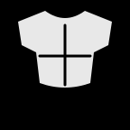

# Durability key

The **Durability** key shows how worn your gear is in World of Warcraft Forever, live, on your Stream Deck.
It needs two parts: the **HeroDeck addon** in the game and the **HeroDeck plugin** in the Stream Deck app.

## What the key shows



- A small armor icon whose **background color** tells you when to repair.
- The **percentage** below the icon (you can hide it, see [Options](#options)).

The value is the durability of your **most damaged equipped item**, not the average: if your weapon is at
10 % and everything else at 100 %, the key shows 10 %. The percentage is rounded down (29.6 % shows 29 %).
With no item that has durability (nothing equipped), the key shows 100 %.

| Durability | Background |
|---|---|
| 50 % – 100 % | black |
| 20 % – 49 % | yellow |
| 0 % – 19 % | red |
| no data | grey, `--` |

The key updates about once a second after your gear changes (damage, repair, equip, unequip).

## Install

Requirements: Windows 10/11, Stream Deck app 7.1 or newer, WoW Forever in **windowed** or **windowed
(fullscreen)** mode.

### 1. The addon

Copy the `addon/HeroDeck` folder into the game's AddOns folder, so that you get:

```
<WoW folder>\_forever_\Interface\AddOns\HeroDeck\HeroDeck.toc
```

For example `D:\Games\World of Warcraft\_forever_\Interface\AddOns\HeroDeck`.

Developers can link the folder instead of copying it, so the game always loads the code from the repo:

```bash
cmd /c mklink /J "D:\Games\World of Warcraft\_forever_\Interface\AddOns\HeroDeck" "D:\Git\herodeck\addon\HeroDeck"
```

Start the game. On the character screen, open **AddOns** and check that **HeroDeck** is enabled. If it is
marked out of date, tick **Load out of date AddOns**.

### 2. The plugin

Build and link it from the repo:

```bash
cd streamdeck
npm install
npm run build
npx streamdeck link com.devilcable.herodeck.sdPlugin
```

Then **quit the Stream Deck app completely and start it again** (a new plugin is only found when the app
starts).

### 3. The key

In the Stream Deck app, open the **HeroDeck** category in the action list and drag **Durability**
(**Durabilité** in French) onto a key.

## Options

Select the key in the Stream Deck app to see its settings:

- **Show percentage** (default: on). Turn it off to see only the colored icon.

## The small strip in the top-left corner

The addon cannot talk to the Stream Deck directly: WoW addons have no network or file access. So the
addon draws a tiny strip of colored pixels (about 18 × 3 pixels) in the **top-left corner** of the game
screen, and the plugin reads it from a capture of the game window. This is why you see a few colored dots
in that corner. Do not cover that corner with another window.

The plugin only **reads** the game window. It never presses keys or acts in the game.

## When the key shows `--` (grey)

The plugin could not read the strip. Usual causes:

- WoW is not running, or it is **minimized** to the taskbar.
- A **loading screen** is showing: the key turns grey for the length of the loading screen and comes back
  by itself. Short loading screens (under about 1.5 s) are not visible.
- The game runs in **exclusive fullscreen**: switch to windowed or windowed (fullscreen).
- The HeroDeck addon is not enabled (check the **AddOns** list on the character screen).
- **Windows HDR** or a display scaling other than 100 % has not been tested yet; if the key stays grey with
  one of them on, try turning it off.

When WoW is only **in the background** (another window on top, but not minimized), the game keeps running
and the key keeps showing the live value.

## Troubleshooting for developers

With the game running, the probe prints what the plugin sees twice a second:

```bash
cd streamdeck
npm run probe
```

It shows the decoded value, the capture path (`window` or `monitor`), the capture time, and, when nothing
is decoded, why: no window titled `World of Warcraft`, or the raw colors of the header it found. Add
`-- --dump <folder>` to save the captured corner as a PNG.
